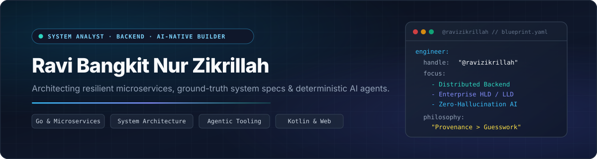
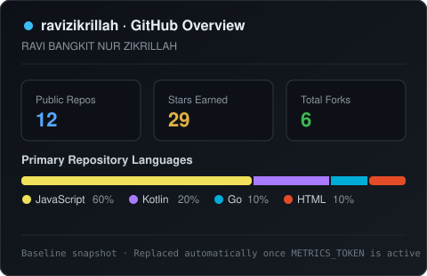

  

<h1 align="center">Hi, I'm Ravi Zikrillah! 👋</h1>

  
  

<h3 align="center">🛠️ Languages, Architecture &amp; Tools</h3>

  
   
  
   
  

  
  
  
  
  
  
  
  
   
  
  
  
  

  <picture>
    <source media="(prefers-color-scheme: dark)" srcset="https://raw.githubusercontent.com/ravizikrillah/ravizikrillah/output/github-snake-dark.svg" />
    <source media="(prefers-color-scheme: light)" srcset="https://raw.githubusercontent.com/ravizikrillah/ravizikrillah/output/github-snake.svg" />
    
  </picture>

<table width="100%">
  <tr>
    <td width="48%" valign="top">
      

        
      

      <h3>🚀 Featured Open Source</h3>
      <ul>
        <li>
          <a href="https://github.com/ravizikrillah/second-brain"><b>second-brain</b></a> — Universal System Analyst &amp; Architectural Second Brain for AI Agents with strict provenance citations.
        </li>
        <li>
          <a href="https://github.com/ravizikrillah/ui-design"><b>ui-design</b></a> — Anti-slop UI/UX Design &amp; Frontend Engineering Engine with <code>DESIGN.md</code> contracts and Playwright verification.
        </li>
        <li>
          <a href="https://github.com/ravizikrillah/BatteryLock"><b>BatteryLock</b></a> &amp; <a href="https://github.com/ravizikrillah/ChargeLock"><b>ChargeLock</b></a> — Child-safe Android battery hysteresis &amp; charging locks with Family Link integration.
        </li>
        <li>
          <a href="https://github.com/ravizikrillah/CleanFrame-AndroidTV"><b>CleanFrame-AndroidTV</b></a> — Distraction-free Google TV / Android TV home launcher with Art Mode screensaver.
        </li>
      </ul>
    </td>
    <td width="52%" valign="top">
      <h3>🌐 Let's Connect and Grow Together!</h3>
      

        
        <!-- Uncomment dan isi username asli kamu jika ingin menampilkan LinkedIn / YouTube / Instagram seperti OfficialCodeVoyage:
        
        
        
        -->
      

      <h3>🧑‍💻 About Me</h3>
      

        I'm a <b>System Analyst</b>, <b>Backend Engineer</b>, and <b>AI-Native Builder</b> focused on turning complex business domains into traceable system architectures, resilient microservices, and deterministic AI workflows.
      

      

        Whether designing enterprise Low-Level Designs (LLDs), event-driven Go services, or open-source AI agent skills, I care deeply about clarity, zero-hallucination provenance, and software that solves real everyday problems.
      

      <h3>⚡ Engineering Focus</h3>
      <ul>
        <li><b>System Architecture:</b> HLD/LLD specifications, PlantUML sequence standards, REST &amp; gRPC interface contracts.</li>
        <li><b>Distributed Backend:</b> Go microservices, API Gateways (Kong), Kafka event streams, PostgreSQL &amp; Redis.</li>
        <li><b>AI-Native Tooling:</b> Deterministic agent skills, architectural knowledge graphs &amp; automated verification pipelines.</li>
        <li><b>Product Craft:</b> Purpose-built Android / Android TV apps (Kotlin) and lightweight web utilities.</li>
      </ul>
    </td>
  </tr>
</table>
